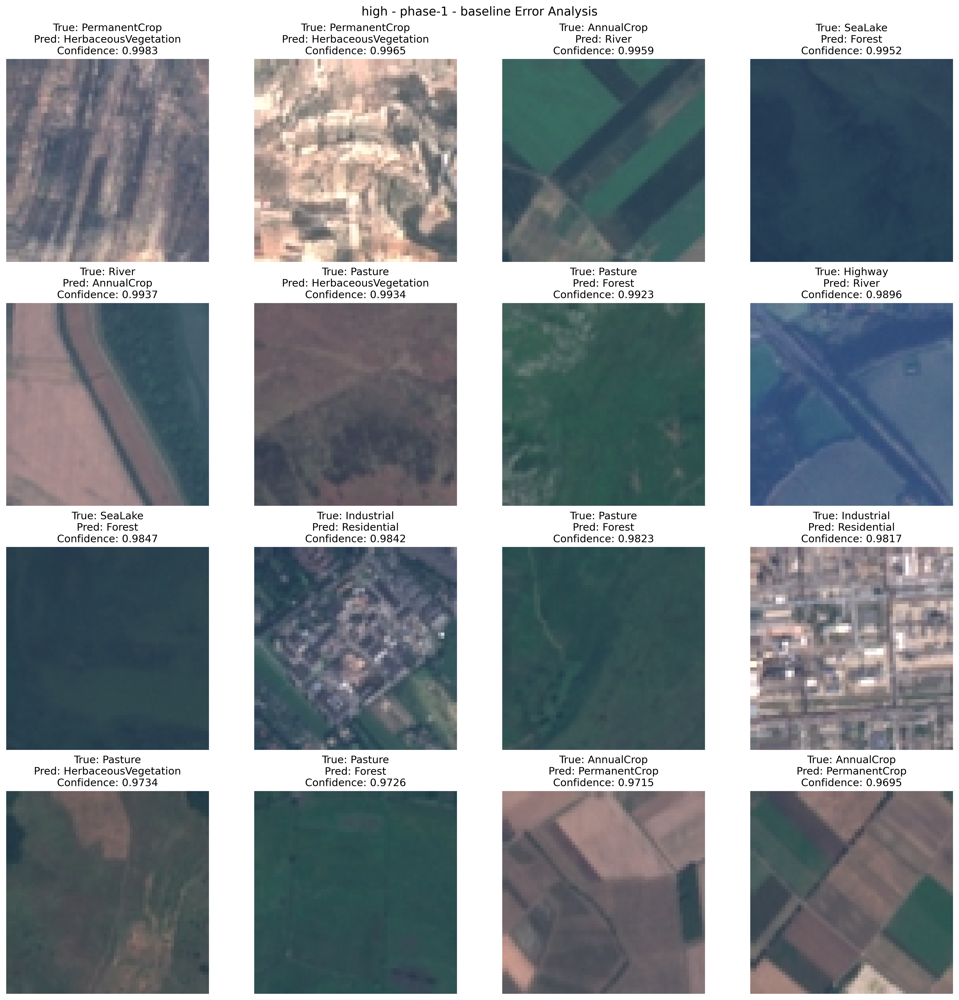
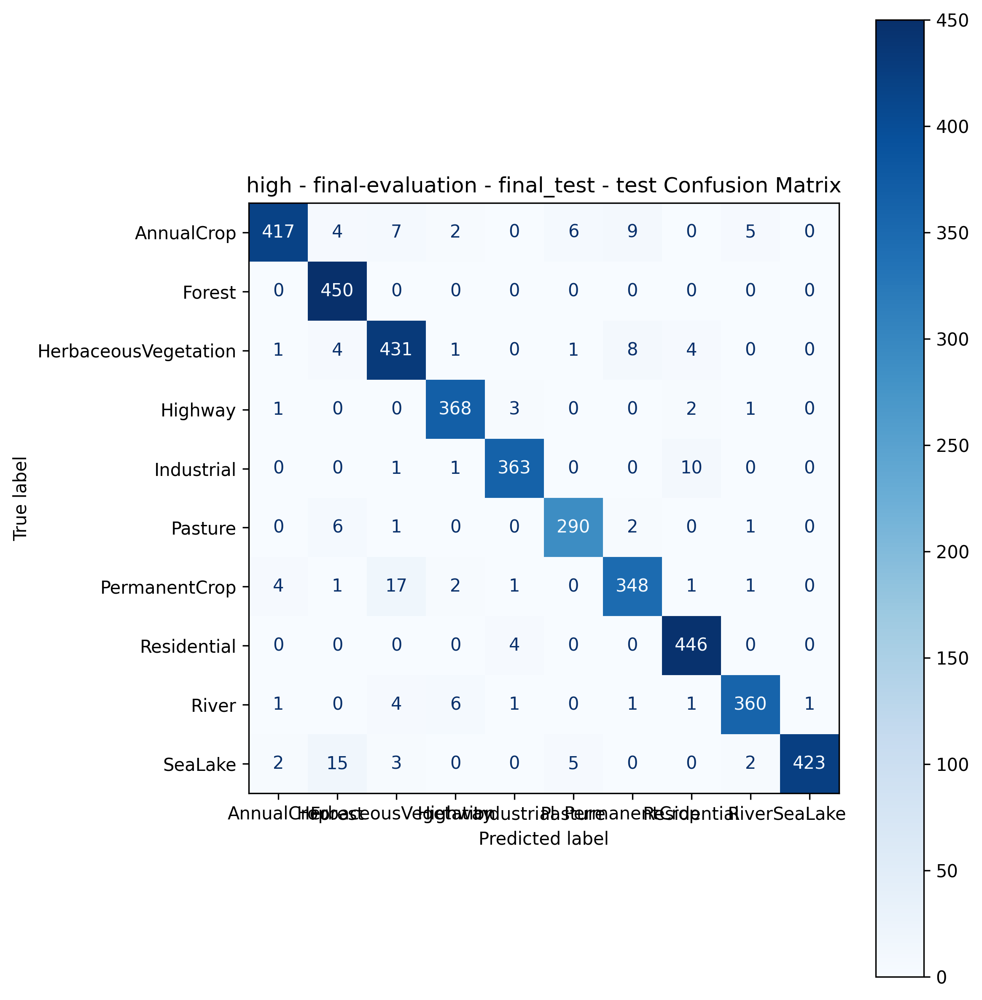
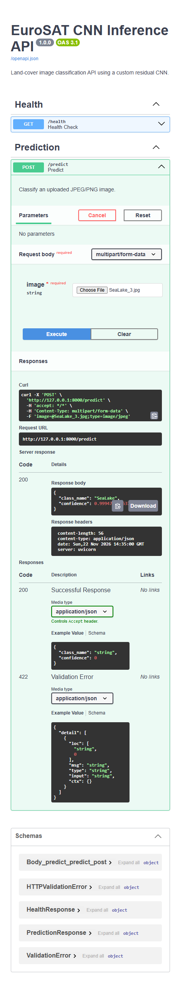

# EuroSAT Land-Use Classification with a Residual CNN

A custom residual CNN for 10-class land-use classification on the EuroSAT RGB dataset, with a focus on **error analysis** and **Grad-CAM interpretability** rather than accuracy alone.

## Pretrained Model

The final **High-FLOPs Custom CNN** is publicly available on Hugging Face.

**[View Model on Hugging Face](https://huggingface.co/DavoodParsi/eurosat-land-cover-classifier)**

| Property | Value |
|---|---|
| Model | High-FLOPs Custom CNN |
| Framework | TensorFlow / Keras |
| Model Format | Keras (`.keras`) |
| Model Size | 67.8 MB |
| Input Shape | 64 × 64 × 3 |
| Number of Classes | 10 |
| Test Accuracy | 96.20% |
| Macro F1 | 0.9620 |

The Hugging Face repository includes the final trained model, class mapping, model configuration, and inference instructions.

The model can be downloaded and used independently of the training and deployment code in this repository.

## Results (Phase 1 baseline, validation set)

| Metric | Value |
|---|---|
| Accuracy | 96.23% |
| Macro F1 | 0.9619 |
| Validation loss | 0.1088 |
| Parameters | 3.54M |

The test set was kept locked during training, tuning and model selection. It was evaluated once at the end; see [Final test results](#final-test-results).


### Error analysis

153 of 4,054 validation images are misclassified, and 55 of those errors (36%) have confidence of at least 0.80. The errors cluster around a few visually overlapping class pairs:

- SeaLake → Forest (largest pair, 21 errors)
- PermanentCrop → HerbaceousVegetation
- Pasture → Forest
- AnnualCrop → PermanentCrop
- AnnualCrop → River

Grad-CAM and visual inspection suggest shared vegetation/texture cues and ambiguous blue/green regions. These are treated as hypotheses, not confirmed causes.




### Experiment 1: larger input (128×128)

An interrupted run reached 96.69% validation accuracy (loss 0.0973) before training was stopped by hardware limits. Because it did not finish, it is documented as promising but inconclusive. Phase 2 (hyperparameter search and retraining) is described below.

## Phase 2: Hyperparameter tuning

A 27-configuration grid search using W&B Sweeps (learning rate: 5e-5 / 1e-4 / 2e-4, weight decay: 1e-5 / 1e-4 / 1e-3, dropout: 0.3 / 0.4 / 0.5; 15 epochs per trial) selected the configuration with the lowest validation loss: `learning rate = 2e-4, weight decay = 1e-4, dropout = 0.3`.

Retrained with the same training budget as the Baseline (up to 50 epochs, early stopping patience 5), it **did not beat the Baseline**. Therefore, the Baseline configuration of the High-FLOPs Custom CNN remains the selected final model.

| Model (validation set) | Loss | Accuracy | Macro F1 | Errors | SeaLake → Forest |
|---|---|---|---|---|---|
| Baseline | 0.1088 | 96.23% | 0.9619 | 153 | 21 |
| Tuned | 0.1278 | 95.56% | 0.9559 | 180 | 40 |

The short 15-epoch sweep may have favoured fast-learning configurations (higher learning rate, lower dropout). The tuned configuration gained almost nothing from the longer training budget, while the Baseline configuration improved substantially (validation loss: 0.1921 to 0.1088).

This is a hypothesis, not a confirmed explanation: each configuration was evaluated with a single seed, and the best of 27 configurations was selected using the same validation set.

**Experiment Tracking:** Weights & Biases (W&B) was used for experiment tracking and hyperparameter optimization. The project workspace is private, but the key results—including sweep rankings, the selected configuration, and model comparison tables—are publicly available in [`results/`](results/).

Section 3.5.2 of the notebook loads the saved ranking from `results/valid_sweep_comparison.csv`, so the following sections can be followed without W&B access.

## Final test results

The selected **High-FLOPs Custom CNN (Baseline configuration)** was evaluated **once** on the held-out test set (4,050 images), after all training, tuning and model-selection decisions were finished. No decision was changed after seeing these results.

| Metric | Value |
|---|---|
| Accuracy | 96.20% |
| Macro F1 | 0.9620 |
| Weighted F1 | 0.9619 |
| Test loss | 0.1060 |
| Misclassified | 154 / 4,050 |

The test accuracy (96.20%) is very close to the validation accuracy (96.23%), which is consistent with the validation-based selection not having overfitted to the validation set.



### Per-class results

| Class | Precision | Recall | F1 | Support |
|---|---|---|---|---|
| AnnualCrop | 0.9789 | 0.9267 | 0.9521 | 450 |
| Forest | 0.9375 | 1.0000 | 0.9677 | 450 |
| HerbaceousVegetation | 0.9289 | 0.9578 | 0.9431 | 450 |
| Highway | 0.9684 | 0.9813 | 0.9748 | 375 |
| Industrial | 0.9758 | 0.9680 | 0.9719 | 375 |
| Pasture | 0.9603 | 0.9667 | 0.9635 | 300 |
| PermanentCrop | 0.9457 | 0.9280 | 0.9367 | 375 |
| Residential | 0.9612 | 0.9911 | 0.9759 | 450 |
| River | 0.9730 | 0.9600 | 0.9664 | 375 |
| SeaLake | 0.9976 | 0.9400 | 0.9680 | 450 |

- Strongest classes (F1): Residential (0.9759), Highway (0.9748), Industrial (0.9719)
- Weakest classes (F1): PermanentCrop (0.9367), HerbaceousVegetation (0.9431), AnnualCrop (0.9521)

### Main confusions (true → predicted)

| Pair | Count |
|---|---|
| PermanentCrop → HerbaceousVegetation | 17 |
| SeaLake → Forest | 15 |
| Industrial → Residential | 10 |
| AnnualCrop → PermanentCrop | 9 |
| HerbaceousVegetation → PermanentCrop | 8 |

The pairs are similar to those found on the validation set (for example SeaLake → Forest and PermanentCrop → HerbaceousVegetation). Each pair has a small count, so these are descriptive patterns, not statistically tested claims.

### Model complexity

| Item | Value |
|---|---|
| Parameters | 3,544,266 |
| FLOPs per image | about 3.95 billion (TensorFlow profiler, about 2 × MACs) |
| Checkpoint size | 67.8 MB |
| Throughput (Tesla T4, batch 32) | about 1,197 images/s |

All test results are saved in [`results/final_test/`](results/final_test/). The final report is [`high_final_evaluation_final_report.md`](results/final_test/high_final_evaluation_final_report.md). Raw predictions are not stored in the repository.

The final model is included in [`deploy/`](deploy/) for the local inference API. A public copy is also available through the Hugging Face Model Repository linked above.

## Model and training

- ResNet-style CNN: stem conv, three residual stages (64/128/256 filters, 2 blocks each), global average pooling, dense head
- Augmentation inside the model: flips, rotation, zoom
- AdamW (learning rate 1e-4, weight decay 1e-4), categorical cross-entropy
- Early stopping, checkpointing and LR reduction on plateau
- Experiment tracking with Weights & Biases

## Deployment (local FastAPI service)

The final model is served by a FastAPI app in [`deploy/`](deploy/). It accepts a JPEG/PNG image (max 5 MB) and returns the predicted class and confidence. The model resizes inputs to 64×64 and rescales pixels internally, so no extra preprocessing is needed.

### Run with Python

```bash
cd deploy
pip install -r requirements.txt
uvicorn main:app
```

Then open [http://127.0.0.1:8000/docs](http://127.0.0.1:8000/docs), choose `POST /predict`, click **Try it out** and upload an image.

### Run with Docker

```bash
cd deploy
docker build -t eurosat-api .
docker run -p 7860:7860 eurosat-api
```

Then open [http://127.0.0.1:7860/docs](http://127.0.0.1:7860/docs). Note: the Docker setup has not been tested yet.

### Endpoints

| Endpoint | Description |
|---|---|
| `GET /health` | Service status |
| `POST /predict` | Returns `class_name` and `confidence` |

Example response:



```json
{
  "class_name": "Pasture",
  "confidence": 0.9957
}
```

The service runs locally. It is not hosted online.

## Repository structure

```text
cnn-eurosat/
├── notebooks/
│   └── CNN_High_FLOPs.ipynb
├── results/
│   ├── Phase 2 result tables
│   └── final_test/
│       ├── Final test metrics
│       ├── Final report
│       ├── Confusion matrix
│       └── Model complexity
├── data/
│   └── split_manifest.csv
├── deploy/
│   ├── FastAPI inference service
│   ├── Dockerfile
│   └── Final model
└── src/
    └── eurosat_cnn/
        ├── config.py
        ├── environment.py
        ├── data.py
        ├── models.py
        ├── train.py
        ├── evaluate.py
        ├── error_analysis.py
        ├── explain.py
        ├── visualization.py
        ├── reporting.py
        ├── tracking.py
        └── split_manifest.py
```

The notebook contains the full analysis (Phase 1, Phase 2 and the final test evaluation in Section 4) with its own inline code. The `eurosat_cnn` package is the reusable, tested version of the same utilities.

## Setup

Python 3.10 or newer (tested with 3.12).

```bash
pip install -r requirements.txt
pip install -e .
```

### Dataset

The train/val/test split used in this project is stored in `data/split_manifest.csv` (one row per image: `filepath,label,split`). It lists 27,000 images: train 18,895, val 4,055, test 4,050. Choose one option:

**Option A: rebuild my exact split** from the original EuroSAT RGB dataset (a folder that directly contains the ten class folders):

```bash
python src/eurosat_cnn/split_manifest.py build --source <path-to-original-EuroSAT> --output data/EuroSAT_RGB
python src/eurosat_cnn/split_manifest.py verify
```

The original dataset is only read, never modified. `verify` compares the result with the manifest.

**Option B: make your own split** into `data/EuroSAT_RGB/train`, `val` and `test` (one subfolder per class). Results will then differ slightly from those reported.

Note: the reported results use 4,054 validation images because one image (`SeaLake_1.jpg`) was missing from the validation copy used during training. The manifest lists all 4,055. The training copy also contained one duplicate Forest image, which is not in the manifest. The effect on results is expected to be negligible.

### Configuration

Set the environment variable `EUROSAT_PROJECT_ROOT` to use a different project folder (for example on Google Drive).

Weights & Biases is optional: run `wandb login`, or set `WANDB_MODE=offline`.

## Status

Phase 1 (baseline and error analysis), Phase 2 (hyperparameter tuning, Baseline configuration retained) and the final test evaluation are complete.

Final result: **96.20% test accuracy, macro F1 0.9620**.

A FastAPI inference service for the final model is available in `deploy/` for local use.

The final trained model is also publicly available on [Hugging Face](https://huggingface.co/DavoodParsi/eurosat-land-cover-classifier).

## Feedback

If you run into an error or something doesn't work, please [open an issue](https://github.com/DavoodParsi/cnn-eurosat/issues).