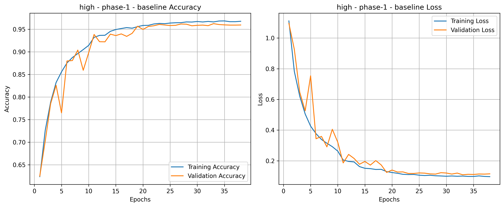
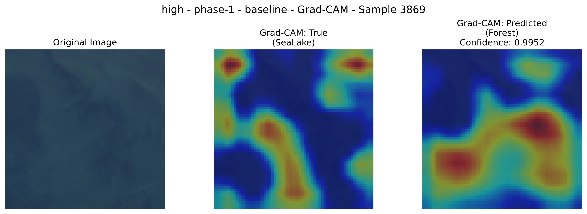

# EuroSAT Land-Use Classification with a Residual CNN

A custom residual CNN for 10-class land-use classification on the EuroSAT RGB dataset, with a focus on **error analysis** and **Grad-CAM interpretability** rather than accuracy alone.

## Results (Phase 1 baseline, validation set)

| Metric | Value |
|---|---|
| Accuracy | 96.23% |
| Macro F1 | 0.9619 |
| Validation loss | 0.1088 |
| Parameters | 3.54M |

The test set is locked and has not been evaluated.

### Error analysis

153 of 4,054 validation images are misclassified, and 55 of those errors (36%) have confidence of at least 0.80. The errors cluster around a few visually overlapping class pairs:

- SeaLake → Forest (largest pair, 21 errors)
- PermanentCrop → HerbaceousVegetation
- Pasture → Forest
- AnnualCrop → PermanentCrop
- AnnualCrop → River

Grad-CAM and visual inspection suggest shared vegetation/texture cues and ambiguous blue/green regions. These are treated as hypotheses, not confirmed causes.

### Experiment 1: larger input (128×128)

An interrupted run reached 96.69% validation accuracy (loss 0.0973) before training was stopped by hardware limits. Because it did not finish, it is documented as promising but inconclusive. Phase 2 (hyperparameter search and retraining) is described below.

## Phase 2: Hyperparameter tuning

A 27-configuration grid search using W&B Sweeps (learning rate: 5e-5 / 1e-4 / 2e-4, weight decay: 1e-5 / 1e-4 / 1e-3, dropout: 0.3 / 0.4 / 0.5; 15 epochs per trial) selected the configuration with the lowest validation loss: `learning rate = 2e-4, weight decay = 1e-4, dropout = 0.3`.

Retrained with the same training budget as the Baseline (up to 50 epochs, early stopping patience 5), it **did not beat the Baseline**, so the Baseline remains the final model.

| Model (validation set) | Loss | Accuracy | Macro F1 | Errors | SeaLake → Forest |
|---|---|---|---|---|---|
| Baseline | 0.1088 | 96.23% | 0.9619 | 153 | 21 |
| Tuned | 0.1278 | 95.56% | 0.9559 | 180 | 40 |

The short 15-epoch sweep may have favoured fast-learning configurations (higher learning rate, lower dropout). The tuned configuration gained almost nothing from the longer training budget, while the Baseline configuration improved substantially (validation loss: 0.1921 to 0.1088).

This is a hypothesis, not a confirmed explanation: each configuration was evaluated with a single seed, and the best of 27 configurations was selected using the same validation set.

**Experiment Tracking:** Weights & Biases (W&B) was used for experiment tracking and hyperparameter optimization. The project workspace is private, but the key results—including sweep rankings, the selected configuration, and model comparison tables—are publicly available in [`results/`](results/).

Section 3.5.2 of the notebook loads the saved ranking from `results/valid_sweep_comparison.csv`, so the following sections can be followed without W&B access.

## Model and training

- ResNet-style CNN: stem conv, three residual stages (64/128/256 filters, 2 blocks each), global average pooling, dense head
- Augmentation inside the model: flips, rotation, zoom
- AdamW (learning rate 1e-4, weight decay 1e-4), categorical cross-entropy
- Early stopping, checkpointing and LR reduction on plateau
- Experiment tracking with Weights & Biases

## Repository structure

    notebooks/CNN_High_FLOPs.ipynb   Phase 1 and Phase 2 analysis (committed without outputs)
    results/                         Phase 2 result tables (sweep ranking, selected config, baseline vs tuned)
    data/split_manifest.csv          Train/val/test split (one row per image)
    src/eurosat_cnn/                 Reusable package
        config.py                    Constants and paths
        environment.py               Seeds, GPU and mixed precision
        data.py                      Dataset loading and sanity checks
        models.py                    Augmentation, residual block, CNN
        train.py                     Callbacks, LR schedules, compilation
        evaluate.py                  Metrics
        error_analysis.py            Error and confidence analysis
        explain.py                   Grad-CAM
        visualization.py             Plots and reports
        reporting.py                 Model reports
        tracking.py                  W&B utilities
        split_manifest.py            Create, build and verify the split from the manifest

The notebook is a snapshot of the analysis up to Phase 2 and contains its own inline code. The `eurosat_cnn` package is the reusable, tested version of the same utilities.

## Setup

Python 3.10 or newer (tested with 3.12).

    pip install -r requirements.txt
    pip install -e .

### Dataset

The train/val/test split used in this project is stored in `data/split_manifest.csv` (one row per image: `filepath,label,split`). It lists 27,000 images: train 18,895, val 4,055, test 4,050. Choose one option:

**Option A: rebuild my exact split** from the original EuroSAT RGB dataset (a folder that directly contains the ten class folders):

    python src/eurosat_cnn/split_manifest.py build --source <path-to-original-EuroSAT> --output data/EuroSAT_RGB
    python src/eurosat_cnn/split_manifest.py verify

The original dataset is only read, never modified. `verify` compares the result with the manifest.

**Option B: make your own split** into `data/EuroSAT_RGB/train`, `val` and `test` (one subfolder per class). Results will then differ slightly from those reported.

Note: the reported results use 4,054 validation images because one image (`SeaLake_1.jpg`) was missing from the validation copy used during training. The manifest lists all 4,055. The training copy also contained one duplicate Forest image, which is not in the manifest. The effect on results is expected to be negligible.

### Configuration

Set the environment variable `EUROSAT_PROJECT_ROOT` to use a different project folder (for example on Google Drive).

Weights & Biases is optional: run `wandb login`, or set `WANDB_MODE=offline`.

## Status

Phase 1 (baseline and error analysis) and Phase 2 (hyperparameter tuning, Baseline retained) are complete. Final evaluation on the test set is next.